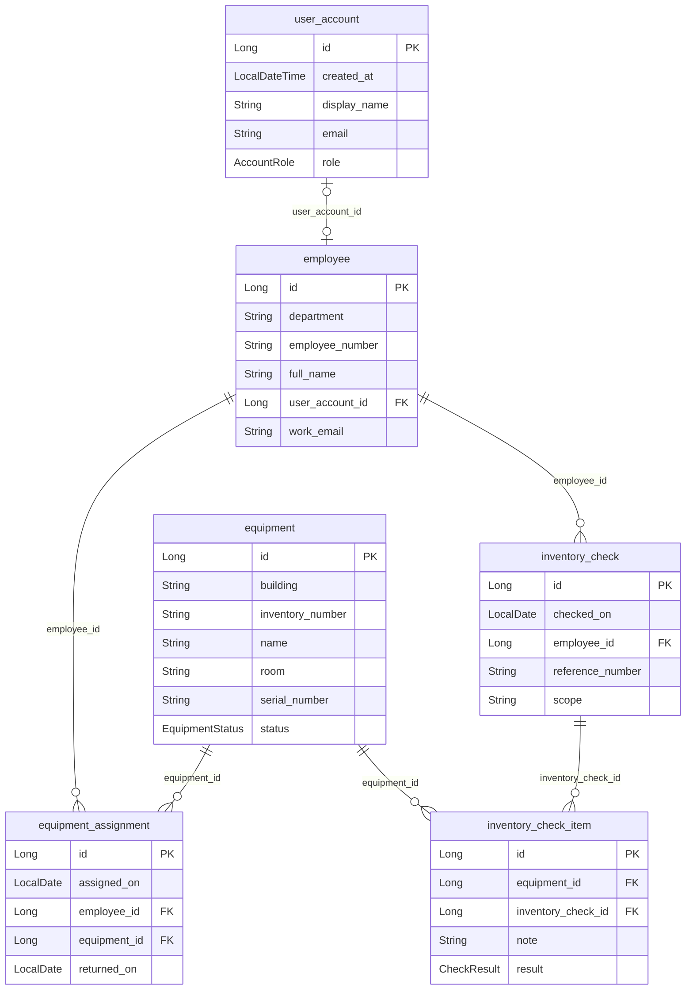

# Schemat bazy danych

Plik generują reguły projektu (panel Maven → Lifecycle → verify). Nie edytujcie go ręcznie.

Tabele: 6 · kolumny: 33 · relacje: 5 × @ManyToOne, 1 × @OneToMany, 1 × @OneToOne, 0 × @ManyToMany

| Tabela | Encja | Kolumny | Klucze obce |
|---|---|---|---|
| employee | Employee | 6 | user_account_id |
| equipment | Equipment | 7 | — |
| equipment_assignment | EquipmentAssignment | 5 | employee_id, equipment_id |
| inventory_check | InventoryCheck | 5 | employee_id |
| inventory_check_item | InventoryCheckItem | 5 | equipment_id, inventory_check_id |
| user_account | UserAccount | 5 | — |

