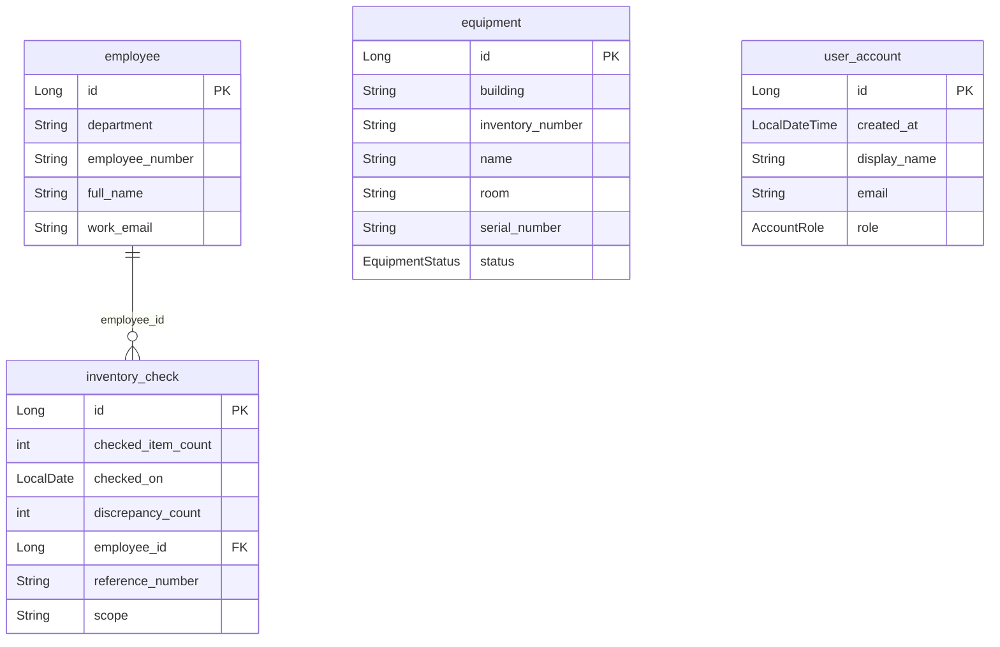

# Schemat bazy danych

Plik generują reguły projektu (panel Maven → Lifecycle → verify). Nie edytujcie go ręcznie.

Tabele: 4 · kolumny: 24 · relacje: 1 × @ManyToOne, 0 × @OneToMany, 0 × @OneToOne, 0 × @ManyToMany

| Tabela | Encja | Kolumny | Klucze obce |
|---|---|---|---|
| employee | Employee | 5 | — |
| equipment | Equipment | 7 | — |
| inventory_check | InventoryCheck | 7 | employee_id |
| user_account | UserAccount | 5 | — |

